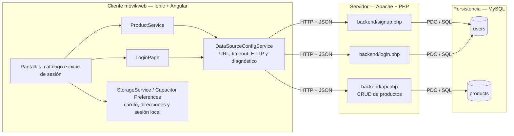

# Arquitectura Cliente–API–Base de datos

**Proyecto:** GlowBeauty / BeautyStore 2.0
**Curso:** Programación de Móviles II
**Tecnologías:** Ionic, Angular, Capacitor, PHP, PDO y MySQL
**Estado del documento:** análisis de la implementación actual; no describe funcionalidades futuras como si ya existieran.

## 1. Diagrama de arquitectura



**Flujo:** la interfaz solicita operaciones a servicios Angular; estos construyen la URL desde la configuración del origen de datos y realizan solicitudes HTTP con JSON. Los scripts PHP validan la solicitud, acceden a MySQL mediante PDO y devuelven un código HTTP y un cuerpo JSON. El cliente muestra los resultados y, para productos, conserva un catálogo local de respaldo si la API no está disponible.

## 2. Endpoints y métodos HTTP implementados

La URL base se forma con `protocol`, `host`, `apiPort` y `apiBasePath`, configurables en la aplicación. El valor inicial es `http://localhost:80/backend`. En un emulador Android normalmente se configura el host accesible desde el emulador (por ejemplo, `10.0.2.2` para el servidor local del equipo); en un teléfono físico se requiere la dirección de red del servidor.

| Recurso | Endpoint | Método | Entrada / comportamiento | Respuestas principales |
|---|---|---|---|---|
| Colección de productos | `/api.php` | `GET` | Sin parámetros: lista productos ordenados por ID descendente. | `200`, `data` es una lista y `total` indica su cantidad. |
| Producto | `/api.php?id={id}` | `GET` | Consulta un producto por ID en query string. | `200` con un objeto en `data`; `404` si no existe. |
| Crear producto | `/api.php` | `POST` | JSON: `name` y `price` obligatorios; `description` y `stock` opcionales. | `201` con el ID creado; `400` si faltan campos. |
| Reemplazar producto | `/api.php?id={id}` | `PUT` | JSON: `name` y `price` obligatorios; permite establecer `description` y `stock`. | `200` al ejecutar la actualización; `400` si falta el ID o los campos requeridos. |
| Actualizar producto | `/api.php?id={id}` | `PATCH` | JSON con uno o más de estos campos: `name`, `description`, `price`, `stock`. | `200` al ejecutar la actualización; `400` si falta ID o no hay campos válidos. |
| Eliminar producto | `/api.php?id={id}` | `DELETE` | ID en query string; el código también acepta ID en el cuerpo JSON. | `200` si elimina; `404` si no encuentra el registro. |
| Registrar usuario | `/signup.php` | `POST` | JSON: `name`, `email`, `password`. | `201`; `400` por datos inválidos; `409` por correo ya registrado. |
| Iniciar sesión | `/login.php` | `POST` | JSON: `email`, `password`. | `200` con usuario; `401` si las credenciales no coinciden; `400` por campos faltantes. |

`api.php` permite además `OPTIONS` para solicitudes preflight CORS. Los scripts de autenticación aceptan `POST` y responden `405` para otros métodos. En errores de servidor puede responder `500`. La pantalla **API CRUD** consume desde `ProductService` las operaciones `GET`, `POST`, `PUT`, `PATCH` y `DELETE`; cada solicitud muestra su método, estado HTTP y respuesta, y las llamadas usan una capa Ionic de carga.

No existe actualmente un endpoint de pedidos, pagos, inventario de carrito ni direcciones. El carrito, las direcciones guardadas y la sesión de usuario se mantienen en almacenamiento local del dispositivo mediante servicios Angular/Capacitor.

## 3. Modelos JSON de intercambio

Las solicitudes y respuestas de la API usan `Content-Type: application/json`; los consumidores envían `Accept: application/json`.

### Consulta del catálogo

`GET /api.php`

```json
{
  "status": "success",
  "total": 1,
  "data": [
    {
      "id": 1,
      "name": "L’Élixir Doré Glow Face Oil",
      "description": "Aceite facial nutritivo.",
      "price": "640.00",
      "stock": 24,
      "category": "Skincare",
      "image_url": "https://example.com/product.jpg",
      "created_at": "2026-10-10 12:00:00"
    }
  ]
}
```

Los productos se obtienen de MySQL; según la serialización de PDO/MySQL, `price` puede llegar como cadena decimal. `ProductService` convierte precio e ID a número antes de exponer sus objetos al resto de la interfaz. Los campos opcionales de presentación `rating`, `reviews_count` e `is_featured` se asignan localmente y no son columnas de la tabla `products`.

`GET /api.php?id=1` usa la misma envoltura de estado, pero `data` es un producto individual:

```json
{
  "status": "success",
  "data": {
    "id": 1,
    "name": "L’Élixir Doré Glow Face Oil",
    "description": "Aceite facial nutritivo.",
    "price": "640.00",
    "stock": 24,
    "category": "Skincare",
    "image_url": "https://example.com/product.jpg"
  }
}
```

### Crear producto

`POST /api.php`

```json
{
  "name": "Crema hidratante",
  "price": 520.00,
  "description": "Crema facial.",
  "stock": 12
}
```

Respuesta `201`:

```json
{
  "status": "success",
  "message": "Registro creado exitosamente.",
  "id": "13"
}
```

### Registro e inicio de sesión

`POST /signup.php` recibe:

```json
{
  "name": "Ana Pérez",
  "email": "ana@example.com",
  "password": "una-contraseña"
}
```

`POST /login.php` recibe:

```json
{
  "email": "ana@example.com",
  "password": "una-contraseña"
}
```

Ambas operaciones exitosas devuelven una estructura como esta (el ID del registro puede venir serializado como cadena):

```json
{
  "status": "success",
  "message": "Operación exitosa.",
  "user": {
    "id": "13",
    "name": "Ana Pérez",
    "email": "ana@example.com"
  }
}
```

Los errores mantienen una forma común, aunque el texto depende del endpoint:

```json
{
  "status": "error",
  "message": "Descripción del error."
}
```

## 4. Servicio Angular para consumir la API

La aplicación **ya cuenta con un cliente de API Angular reutilizable y en uso**, basado en servicios inyectables:

- `DataSourceConfigService` centraliza la URL base configurable, el timeout, el envío de solicitudes HTTP mediante Axios, el manejo del JSON y el diagnóstico de respuestas/errores.
- `ProductService` expone `listApiProducts()`, `createProduct()`, `replaceProduct()`, `patchProduct()` y `deleteProduct()` para el CRUD. `getProducts()` también consume `GET /api.php`, adapta los datos al modelo `Product` y conserva el catálogo local de respaldo para la tienda si falla la conexión.
- La ruta `/api-demo` permite ejecutar las cinco operaciones desde Ionic; muestra carga durante solicitudes, respuesta HTTP y errores de API en la interfaz.
- `LoginPage` utiliza el mismo servicio para `POST /login.php` y `POST /signup.php`.
- `StorageService` guarda localmente el estado de la aplicación; no es un cliente de la API ni sincroniza por sí solo carrito o direcciones con el backend.

La abstracción está preparada para consumir los endpoints descritos y puede probar la conexión desde la configuración de origen de datos. La implementación HTTP usa **Axios**, no `HttpClient` de Angular; sigue siendo una integración desde servicios Angular, pero conviene nombrar con precisión la biblioteca utilizada. El host inicial `localhost` es de desarrollo y debe cambiarse por uno alcanzable desde el dispositivo objetivo.

## 5. Explicación y evaluación de la arquitectura

La separación en cliente, servidor y persistencia evita que la interfaz consulte la base de datos directamente. Angular mantiene la presentación y el estado local; PHP ofrece recursos HTTP; PDO ejecuta consultas preparadas contra MySQL. Los endpoints de productos comparten un recurso y utilizan los verbos HTTP para expresar lectura, creación, actualización completa/parcial y eliminación. Autenticación se implementa mediante scripts POST dedicados.

**Estado respecto a los requisitos del curso**

| Requisito | Estado | Evidencia |
|---|---|---|
| Diagrama Cliente → API → Base de datos | Cumple | Diagrama Mermaid de este documento. |
| Lista de endpoints | Cumple | Tabla de endpoints con rutas y finalidad. |
| Métodos HTTP utilizados | Cumple | `GET`, `POST`, `PUT`, `PATCH`, `DELETE` y `OPTIONS` documentados, distinguiendo los que consume la app de los disponibles en backend. |
| Modelo JSON | Cumple | Ejemplos de productos, registro, login y error. |
| Servicios Angular para CRUD | Cumple | `DataSourceConfigService` centraliza el transporte y diagnósticos; `ProductService` implementa GET, POST, PUT, PATCH y DELETE. El transporte usa Axios. |
| Carga, respuestas y errores | Cumple | La pantalla `/api-demo` muestra loading, método y estado HTTP, JSON de respuesta y errores. |
| Evidencia de funcionamiento | Pendiente de captura en el entorno con backend | Instrucciones de captura en README; debe ejecutarse contra la instancia de Apache/MySQL del equipo. |
| Explicación de arquitectura | Cumple | Flujo, responsabilidades y límites descritos en este reporte. |
| Evidencia de análisis/mejora con IA | Cumple como evidencia documental de esta revisión | Ver sección siguiente; identifica el análisis, hallazgos y correcciones documentales sin atribuir a la app funcionalidades inexistentes. |

**Límites y recomendaciones para una siguiente iteración:** implementar y conectar endpoints de pedidos/carrito si el alcance requiere persistencia en servidor; considerar autenticación basada en sesión o token si se protegen operaciones; validar y autorizar operaciones de administración de productos; desplegar con HTTPS y restringir CORS a los orígenes autorizados. El estado actual de autenticación solo verifica credenciales y devuelve un usuario; la app almacena ese perfil localmente y no recibe un token de autenticación. No desplegar las credenciales de desarrollo de MySQL en producción.

## 6. Evidencia de uso de IA

**Actividad registrada:** revisión asistida por IA del diagrama, endpoints, métodos HTTP, contratos JSON y consumo Angular solicitados para esta entrega. La evidencia corresponde a esta revisión y a las correcciones incorporadas en este documento; no afirma que se haya utilizado IA en cambios anteriores del proyecto.

**Solicitud analizada:** “Diagrama Cliente → API → Base de datos. Lista de endpoints requeridos. Métodos HTTP utilizados. Modelo JSON de intercambio de información. Servicio Angular preparado para consumir la API. Explicación de la arquitectura propuesta. Evidencia de uso de IA para analizar o mejorar la arquitectura.”

**Hallazgos de la revisión:** el reporte anterior describía una selección de host por plataforma y una llamada directa desde `ProductService` que no coincidían con el código vigente; omitía los endpoints separados de autenticación; no diferenciaba el CRUD disponible en backend de las operaciones efectivamente llamadas por la app; y no aclaraba que carrito y direcciones se almacenan localmente ni que no existe endpoint de pedidos.

**Mejoras reflejadas:** se actualizó el diagrama con las capas reales; se documentaron las rutas PHP y sus métodos/códigos de respuesta; se añadieron ejemplos JSON; se identificaron los servicios Angular y el uso real de Axios; y se registraron los límites actuales junto con recomendaciones. El CRUD de productos ahora se puede ejecutar desde la pantalla `/api-demo`; la evidencia visual requiere conectar el backend local.

**Verificación humana del análisis:** los nombres de rutas y métodos se contrastaron con `backend/api.php`, `backend/login.php`, `backend/signup.php`; el esquema de datos con `backend/schema.sql`; y el consumo cliente con `src/app/services/data-source-config.service.ts`, `src/app/services/product.service.ts` y `src/app/login/login.page.ts`. La revisión documental no equivale a una auditoría de seguridad ni a una prueba de despliegue contra una instancia MySQL activa.
